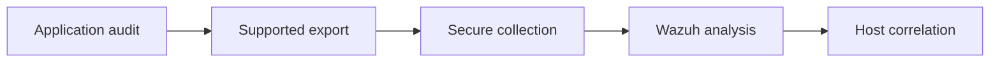
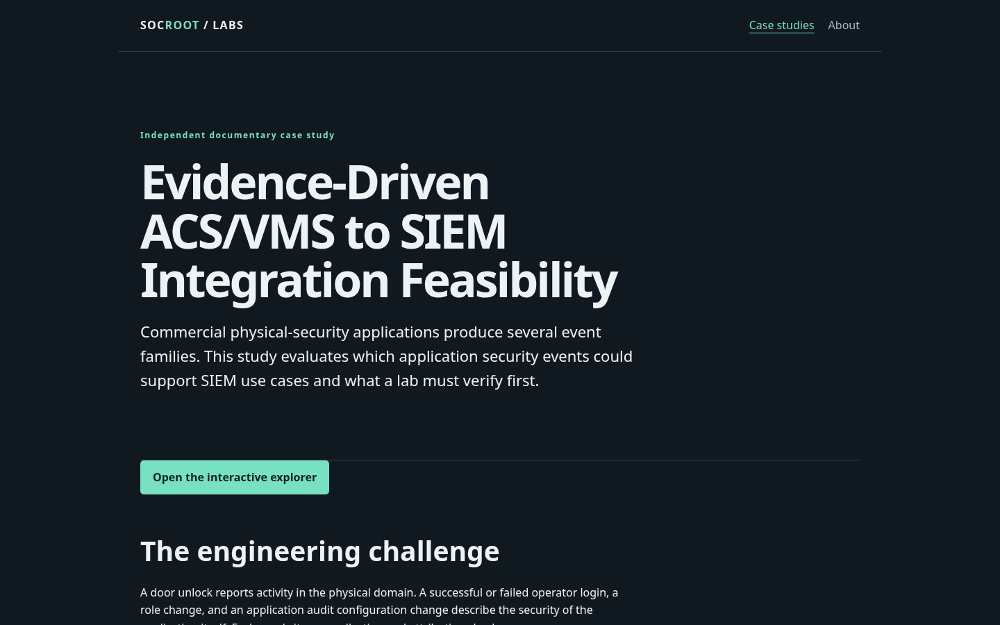

# Evidence-Driven ACS/VMS to SIEM Integration Feasibility

Independent engineering case study and static explorer for application-level cybersecurity telemetry from commercial physical-security products and a proposed Wazuh intake.

Door and camera activity describe physical operations. Operator authentication, role changes and audit settings answer separate application-security questions. A viable route needs an exported event, attributable actor, supported collection and verified raw delivery.

## Selected findings

- AXIS Camera Station Pro was the preferred initial transport-validation candidate among the products assessed.
- Genetec Security Center had the strongest documented application security-event coverage in the assessed group.
- The documentary recommendation is CONDITIONAL GO to scope a transport PoC. Empirical PoC remains open. Production suitability is undetermined.

The diagram represents a proposed route. Every handoff requires validation.

## Explore locally

Run `python3 -m http.server 8000 --bind 127.0.0.1 --directory site` from the repository root. Open [the case study](http://127.0.0.1:8000/case-studies/acs-vms-siem/) or [the explorer](http://127.0.0.1:8000/case-studies/acs-vms-siem/explorer/). The illustrative model demonstrates eligibility gates. Static files are in `site/`, public documentation in `docs/`, and genuine captures in `assets/` when included.

- [Case study](docs/CASE_STUDY.md)
- [Methodology](docs/METHODOLOGY.md)
- [Proposed architecture](docs/ARCHITECTURE.md)
- [Validation boundaries](docs/VALIDATION_BOUNDARIES.md)
- [Technical article](docs/TECHNICAL_ARTICLE.md)
- [Publication rights](RIGHTS.md) and [disclosures](DISCLAIMER.md)

## Captures

[Decision simulator](assets/simulator.png) · [Proposed architecture](assets/architecture.png) · [Mobile case study](assets/mobile-case-study.png)
